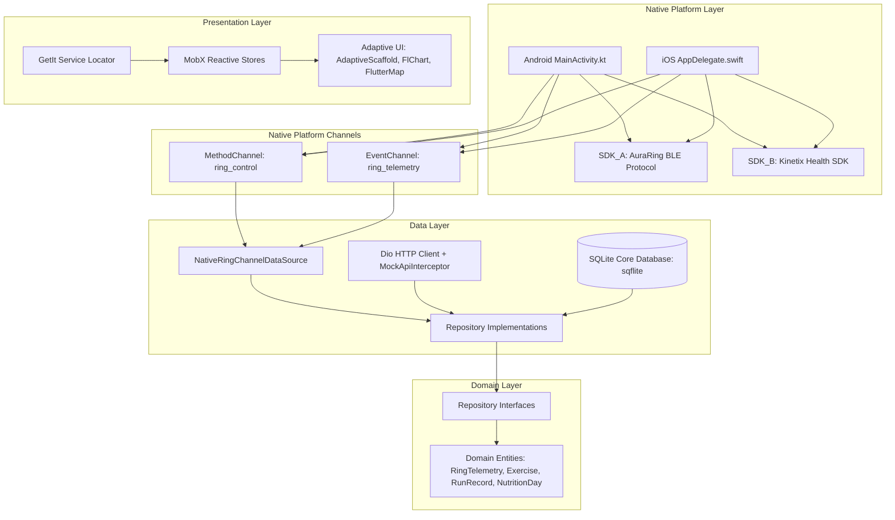
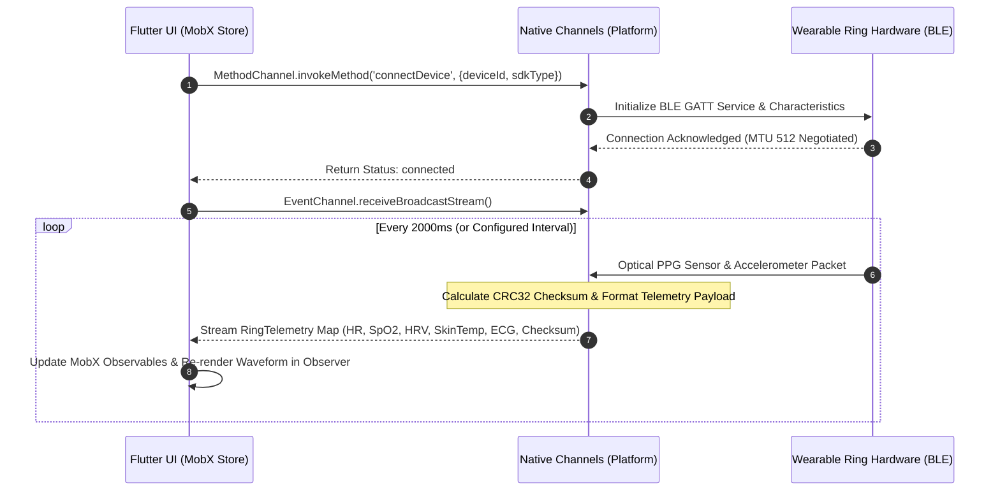

# Fitone: All-in-One Fitness, Wearables & Recovery Ecosystem

[](https://github.com/Safeer-Hussain/fitone/actions)
[](https://flutter.dev)
[](https://dart.dev)
[](https://pub.dev/packages/mobx)
[](#architecture)
[](LICENSE)

> **Clean-room reference architecture demonstrating production patterns, dual native Kotlin/Swift wearable SDK bridges, MobX state management, and offline-first SQL caching.**

Fitone is a mobile fitness, sports science nutrition, GPS outdoor running, and dual smart-ring wearable ecosystem. Built with Flutter, Kotlin, Swift, MobX, and SQLite, it bridges native hardware sensors with a zero-cost local backend and an on-device AI recovery advisor.

---

## Architecture Overview



---

## Native Wearable Bridge Sequence



---

## Core Feature Matrix

| Module | Features Included | Primary Technical Stack |
|---|---|---|
| **Dual Smart-Ring Hub** | Device scanning, SDK switching (AuraRing vs KinetixRing), hardware diagnostics, live ECG waveform buffering, readiness score gauge | `MethodChannel`, `EventChannel`, `fl_chart`, `MobX` |
| **Exercise & Workouts** | 60+ seeded exercises, debounced multi-criteria filtering, active set logger, RPE rating, intraset rest timer, 1RM calculator (Epley/Brzycki) | `sqflite`, `MobX`, custom SVG & PNG equipment renders |
| **Nutrition & Hydration** | Daily calorie & macro target rings, meal category slots (Breakfast, Lunch, Dinner, Snacks), quick-add presets, hydration tracker with streak counter | `sqflite`, Custom progress indicators, reactive MobX store |
| **GPS Outdoor Running** | OpenStreetMap vector engine, live coordinate polyline tracking, Lahore street simulation mode, kilometer splits, pace & elevation calculation | `flutter_map`, `latlong2`, `geolocator`, OpenStreetMap tiles |
| **On-Device AI Coach** | Local SQLite telemetry audit, token-by-token streaming response generator, sports science reasoning chips, quick-action prompts | Local algorithmic engine, asynchronous token streams |
| **Social Athlete Feed** | Workout PR cards, GPS run route shares, leaderboard rankings (tonnage & distance), interactive like toggles, comment threads | `sqflite`, `Dio` Mock Network Interceptor |
| **Developer Debug Hub** | Accessible by long-pressing app version in Settings: toggle 503 errors, simulated network latency slider, telemetry sampling speed | `connectivity_plus`, `Dio` custom interceptor |

---

## Repository Structure

```
fitone/
├── android/
│   └── app/src/main/kotlin/com/example/fitone/MainActivity.kt  # Native Kotlin BLE bridge
├── ios/
│   └── Runner/AppDelegate.swift                                # Native Swift BLE bridge
├── assets/
│   ├── icons/app_icon.png                                     # App launcher emblem
│   └── images/                                                # Wearable renders & equipment art
├── docs/
│   ├── PRD.md                                                 # Complete Product Requirements Document
│   └── AUTONOMOUS_BACKLOG.md                                  # 25 daily engineering sprint items
├── lib/
│   ├── core/
│   │   ├── constants/       # Colors, Typography, Asset registry
│   │   ├── database/        # SQLite migrations, tables, seed dataset
│   │   ├── di/              # GetIt dependency injection registry
│   │   ├── network/         # Dio MockApiInterceptor, NetworkMonitor
│   │   ├── theme/           # Adaptive dark/light themes, ThemeStore
│   │   └── widgets/         # AdaptiveScaffold, Shimmer, ErrorRetry, DebugDrawer
│   ├── data/
│   │   ├── datasources/     # Native platform channels, SQLite sources
│   │   ├── models/          # Telemetry, Exercise, Run, Nutrition DTOs
│   │   └── repositories/    # Repository implementations with offline caching
│   ├── domain/
│   │   ├── entities/        # Core business objects
│   │   └── repositories/    # Abstract repository contracts
│   ├── presentation/
│   │   ├── dashboard/       # Command Hub, Readiness gauge, ECG waveform
│   │   ├── exercise_workout/# 60+ Encyclopedia, Logger, 1RM sheet
│   │   ├── nutrition/       # Macro dashboard, Hydration card
│   │   ├── gps_running/     # Map engine, route plotter, HUD overlay
│   │   ├── ai_coach/        # Streaming AI assistant, reasoning chips
│   │   ├── social_feed/     # Athlete posts, leaderboards, comments
│   │   └── settings/        # Units, Theme, Developer debug drawer
│   └── main.dart            # Application entry point & navigation shell
├── test/                    # Unit and widget test suite
└── pubspec.yaml             # Project dependencies & launcher icon config
```

---

## Getting Started

### Prerequisites
- Flutter SDK 3.47+ / Dart 3.13+
- Android Studio (API 21 through API 35 supported) / Xcode (iOS 13+ supported)

### Installation
```bash
# Clone repository
git clone https://github.com/Safeer-Hussain/fitone-app.git
cd fitone-app/fitone

# Install dependencies
flutter pub get

# Generate launcher icons (if needed)
dart run flutter_launcher_icons

# Run test suite
flutter test

# Run code analysis
flutter analyze

# Launch application
flutter run
```

---

## Autonomous Engineering Engine Protocol

Whenever you prompt:
```text
run daily sprint
```
The autonomous engine automatically:
1. Reads `docs/AUTONOMOUS_BACKLOG.md` and takes the next pending `[ ]` engineering sprint.
2. Implements the production feature end-to-end with zero placeholders and zero emojis.
3. Adds or updates comprehensive unit tests in `test/`.
4. Runs `flutter analyze` and `flutter test` verifying 100% green status.
5. Updates the backlog to `[x]`, stages files, and commits with conventional messages:
   `git commit -m "feat(module): description and unit tests"`
6. Pushes the change directly to `origin main`.
