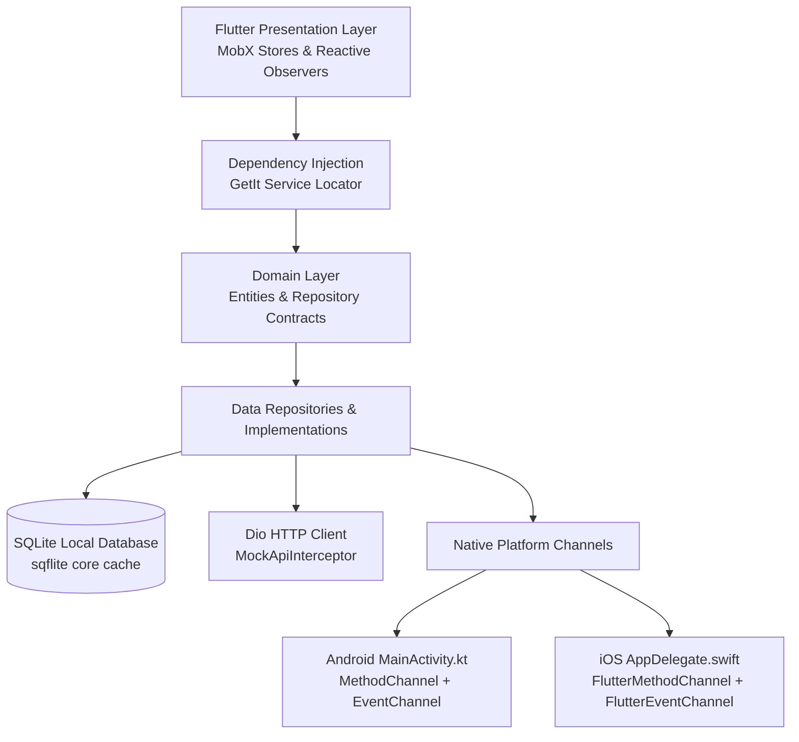

# Fitone: Product Requirements Document (PRD)

## 1. Executive Summary
Fitone is a flagship mobile fitness, sports nutrition, GPS outdoor running, and dual smart-ring wearable ecosystem built using Flutter, Kotlin, and Swift. It bridges native hardware channels with an offline-first architecture, MobX reactive state management, and a local SQLite cache.

## 2. Architectural Pillars
- **Strict Clean Architecture + MVVM**: Clean separation of Domain entities and repository contracts from Data sources (SQLite, Dio Mock Interceptor, MethodChannel/EventChannel) and Presentation (MobX Stores, Observable state, adaptive widgets).
- **Dual Native Wearable Bridges**:
  - `MethodChannel('com.safeer.fitone/ring_control')`: Synchronous and asynchronous device lifecycle commands (scan, pair, disconnect, hardware diagnostics, and telemetry frequency configuration).
  - `EventChannel('com.safeer.fitone/ring_telemetry')`: Continuous asynchronous streaming of raw photoplethysmogram (PPG) waveform packets, heart rate, blood oxygen (SpO2), heart rate variability (HRV), skin temperature delta, sleep stage transitions, and packet CRC checksums.
- **Simulated Third-Party Hardware SDKs**:
  - `SDK_A`: AuraRing BLE Protocol emulation (sub-second sampling, high vagal tone sensitivity).
  - `SDK_B`: Kinetix Health SDK emulation (stochastic activity classification, multi-channel PPG).
- **Zero-Cost Offline-First Backend**:
  - Custom `Dio` Mock Network Interceptor introducing realistic 650ms to 1100ms artificial network latency and REST pagination.
  - Persistent SQLite local database with pre-seeded data for exercises, workout logs, nutrition history, GPS running tracks, and community athlete posts.
  - Reactive `connectivity_plus` network monitor providing real-time sliding offline alert banners and mutation queueing.

## 3. System Architecture

## 4. Native Bridge Specification

### 4.1 Control Channel: `com.safeer.fitone/ring_control`
| Method Name | Parameters | Return Type | Description |
|---|---|---|---|
| `scanDevices` | None | `List<Map<String, dynamic>>` | Scans BLE spectrum and returns detected wearable hardware. |
| `connectDevice` | `deviceId: String`, `sdkType: String` | `Map<String, dynamic>` | Initializes native connection session via target SDK. |
| `disconnectDevice` | None | `Map<String, dynamic>` | Terminates active native BLE link. |
| `getConnectedDevice` | None | `Map<String, dynamic>` | Queries current connection state, active ring ID, and SDK. |
| `setTelemetryFrequency` | `intervalMs: Int` | `Map<String, dynamic>` | Reconfigures native telemetry emission frequency. |
| `runHardwareDiagnostics` | None | `Map<String, dynamic>` | Interrogates optical PPG sensor, IMU, and antenna health. |

### 4.2 Telemetry Channel: `com.safeer.fitone/ring_telemetry`
Streams a continuous map structure every `telemetryIntervalMs`:
- `packetId` (Integer): Auto-incrementing packet sequence identifier.
- `timestamp` (Integer): Epoch milliseconds timestamp.
- `deviceId` (String): Serial identifier of transmitting hardware ring.
- `sdk` (String): Originating native SDK (`SDK_A` or `SDK_B`).
- `heartRate` (Integer): Instantaneous beats per minute (BPM).
- `spo2` (Integer): Peripheral capillary oxygen saturation percentage.
- `hrv` (Integer): Root mean square of successive differences (RMSSD) in milliseconds.
- `skinTempDelta` (Double): Deviation from basal temperature in degrees Celsius.
- `sleepStage` (String): `DEEP`, `REM`, `LIGHT`, or `AWAKE`.
- `stepCount` (Integer): Cumulative daily steps.
- `batteryLevel` (Integer): Retained charge percentage.
- `signalQuality` (Integer): Telemetry signal fidelity percentage.
- `checksum` (String): Cyclic redundancy check (CRC32) hexadecimal digest.
- `ecgSamples` (List<Double>): Instantaneous microvolt voltage points for real-time waveform plotting.

## 5. Core Feature Specifications

### Module A: Command Dashboard & Dual Smart-Ring Hub
- Circular readiness score gauge calculating recovery index (0-100) dynamically derived from nocturnal HRV, resting HR, and sleep architecture.
- Real-time animated ECG / PPG waveform card with 48-sample circular ring buffer.
- Device manager modal allowing scanning, SDK switching, hardware diagnostics, and native packet log inspection.
- 7-day rolling HRV trajectory line chart with baseline comparison.
- Sleep architecture multi-segment breakdown (Deep, REM, Light, Awake).

### Module B: Exercise Encyclopedia, Muscle Filters & Workout Logger
- 60+ seeded exercises categorized across 7 body parts and 6 equipment configurations.
- Real-time debounced multi-criteria search.
- Active workout session logger with sets, reps, weight (kg/lbs conversion), and RPE ratings.
- Automated rest countdown timer with soundless visual pulsing.
- 1RM calculator supporting both Epley and Brzycki strength formulas.
- Weekly workout plan templates (Push Pull Legs, Upper Lower Performance) stored in SQLite.

### Module C: Nutrition, Macronutrient & Hydration Tracker
- Daily energy dashboard with interactive progress rings for calories, protein, carbs, and fats.
- Meal category slots: Breakfast, Lunch, Dinner, and Snacks with deletion and quick-add templates.
- Interactive hydration tracker with 250ml, 500ml, and 750ml quick-log buttons and streak counter.

### Module D: GPS Outdoor Running & Route Tracker
- Map canvas rendered using `flutter_map` with OpenStreetMap raster tiles (zero external API keys or billing dependencies).
- Real-time polyline tracking and GPS waypoint plotting.
- "Simulate Live Run" mode traversing landmark coordinates in Lahore (Liberty Roundabout, Gulberg Boulevard, Siddiq Trade Centre, Canal Road).
- Live HUD displaying running pace (min/km), distance, duration, heart rate zone from smart-ring bridge, elevation gain, and burned energy.
- Automatic split calculations per kilometer and SQLite run persistence.

### Module E: On-Device AI Fitness & Recovery Coach
- Local algorithmic inference engine reading real SQLite telemetry metrics (current HRV, sleep score, consumed protein vs targets, recent workout volume).
- Token-by-token streaming response generator with reasoning progress indicators.
- Quick action prompt shortcuts for workout auto-regulation, high-protein meal planning, and weekly recovery auditing.

### Module F: Social Fitness Feed & Leaderboards
- Community athlete feed with workout PR milestone cards, GPS run route summaries, and recovery benchmarks.
- Interactive like toggles and persistent comment threads saved in SQLite.
- Weekly tonnage and running distance leaderboard rankings with podium badges.

### Module G: Developer & Recruiter Debug Drawer
- Access trigger: Long-pressing app version footer in Settings or tapping the developer action icon.
- Interactive controls:
  - Toggle simulated network latency slider (0ms to 2000ms).
  - Toggle forced API error state (HTTP 503) to inspect error and retry handling.
  - Reconfigure native smart-ring telemetry frequency (500ms High, 2000ms Standard, 5000ms Eco).
  - Toggle manual offline mode simulation.
  - Reset transient run and workout logs.
